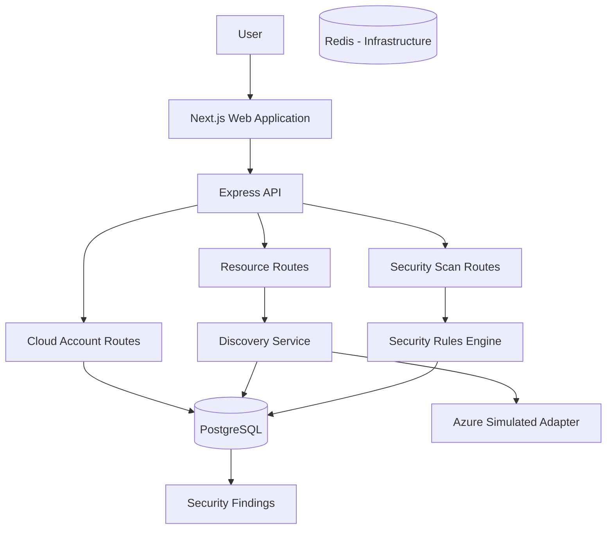
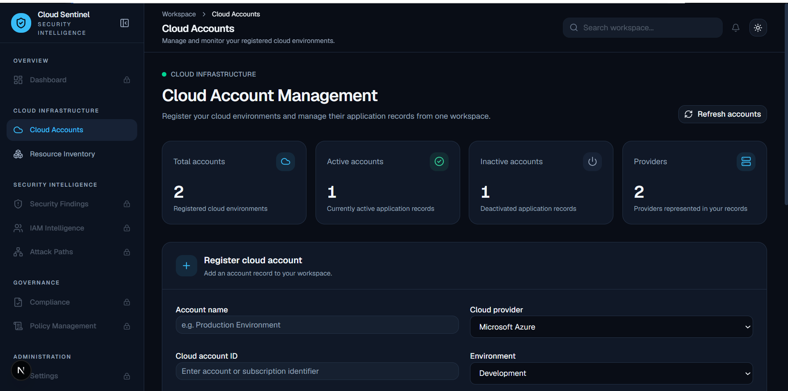
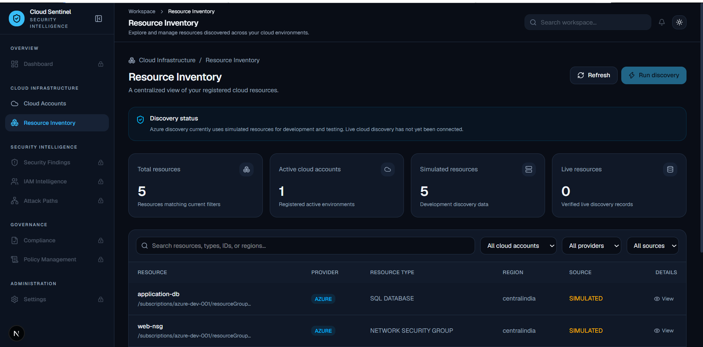

# Cloud Security Intelligence

<p align="center">
  <strong>A cloud security and compliance intelligence platform for discovering cloud resources and identifying configuration risks.</strong>
</p>

<p align="center">
  
  
  
  
  
</p>

<p align="center">
  <a href="#overview">Overview</a> •
  <a href="#current-capabilities">Capabilities</a> •
  <a href="#architecture">Architecture</a> •
  <a href="#getting-started">Getting Started</a> •
  <a href="#api-reference">API</a> •
  <a href="#roadmap">Roadmap</a>
</p>

---

## Overview

**Cloud Security Intelligence** is an actively developed platform for managing cloud-account records, discovering cloud resources, and evaluating resource configurations against security rules.

The project follows a simple workflow:

1. Register a cloud account.
2. Discover and maintain its resource inventory.
3. Run security checks against discovered resources.
4. Store findings with severity, evidence, and remediation guidance.

**Important:** The current Azure discovery adapter uses simulated resource data. It does not yet authenticate to or inspect a live Azure subscription. AWS and GCP account records are supported, but their discovery adapters are not implemented.

## Current Capabilities

| Area | Implementation |
|---|---|
| Cloud accounts | Register, list, view, activate and deactivate |
| Cloud providers | Azure, AWS and GCP account records |
| Resource discovery | Simulated Azure discovery |
| Resource inventory | Register, filter, paginate and retrieve |
| Security evaluation | Rule-based security checks |
| Finding persistence | PostgreSQL and Prisma |
| API validation | Zod |
| Web application | Next.js |
| Local infrastructure | Docker Compose, PostgreSQL and Redis |

## Security Checks

| Rule ID | Security check | Severity |
|---|---|---|
| `AZ-STORAGE-001` | Storage account allows public access | HIGH |
| `AZ-NSG-001` | SSH port 22 allows traffic from any source | CRITICAL |

Each finding contains:
- Rule identifier
- Title and description
- Severity
- Evidence
- Remediation guidance

Findings are stored against their corresponding cloud resources and updated on repeated scans.

> Security results currently come from simulated resource metadata, not live cloud assessments.

## Architecture



### Main Components

- **Frontend:** Next.js 16, React 19, Tailwind CSS.
- **Backend:** Node.js, Express 5, TypeScript and Zod.
- **Database:** PostgreSQL.
- **ORM:** Prisma.
- **Infrastructure:** Docker Compose and Redis.
- **Discovery:** Provider adapter architecture.
- **Security engine:** Rule-based resource evaluation.

Redis is provisioned locally; application-level Redis workflows are not yet implemented.

## Technology Stack

<p align="center">
  
</p>

## Repository Structure

```text
cloud-security-intelligence/
├── apps/
│   ├── api/
│   │   ├── prisma/
│   │   │   ├── migrations/
│   │   │   └── schema.prisma
│   │   └── src/
│   │       ├── discovery/
│   │       ├── routes/
│   │       ├── security/
│   │       ├── __tests__/
│   │       ├── db.ts
│   │       └── server.ts
│   └── web/
│       └── src/
│           ├── app/
│           ├── components/
│           ├── hooks/
│           └── lib/
├── docker-compose.yml
├── package.json
└── package-lock.json
```

## Getting Started

### Prerequisites

- Node.js
- npm
- Docker Desktop
- Docker Compose
- Git

1. Clone the repository

```bash
git clone https://github.com/manjunath-novus/cloud-security-intelligence.git
cd cloud-security-intelligence
```

## Application Screenshots

### Cloud Account Management

The cloud account management workspace allows users to register
cloud environments and monitor their account status.



### Resource Inventory

Explore discovered cloud resources across registered environments.
The current Azure discovery adapter uses simulated development data.


